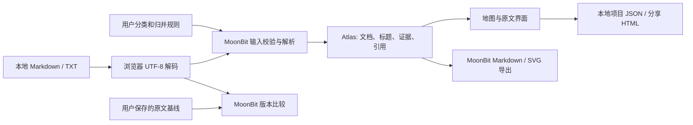

# 架构与数据边界

## 核心数据流

核心无 I/O。输入、规则和图谱都是公开结构类型，支持 JSON 序列化。
`build_atlas` 先整体校验，再按路径排序构建，结果不依赖输入顺序。
浏览器编译目标为 JavaScript；相同核心测试也在 Wasm GC 运行。

## 证据与身份

- 文档 ID 为 `doc:` 加相对路径。
- 标题 ID 包含相对路径、空白/大小写归一后的标题、该标题的出现序号。
  标题前插入普通段落不会改变 ID；修改标题或在之前增加同名标题可能改变身份。
- 每个标题拥有从其行首到下一标题之前的行范围；这不是整个嵌套子树范围。
  证据 quote 最多 1,200 个 Unicode 字符，完整原文保存在项目文档中。
- 文档显示名、主题是外部偏好，不改写源文本。预设优先级：用户主题 > topic 元数据 > 一级目录 > 未分类。
- 完全相同内容按原文逐字比较，不使用哈希和模糊相似性。
- 概念规则显式保存为 name → target。允许链式归并，不允许非平凡循环。
  映射预先解析，所有文档共享结果；不同标点名称仍不同，例如 C 与 C++。

## 解析范围

Markdown 标题仅支持最多三级空格缩进的 ATX `#` 至 `######` 后接空白。
不解析 Setext、列表中的标题、HTML 标题、表格语义或 Markdown 行内样式。
识别反引号/波浪线围栏；忽略四空格和 Tab 缩进代码。TXT 保持原样，不解释元数据或标题。
元数据必须从第一行 `---` 开始，在前 100 行内由 `---` 关闭；仅处理 topic 与简单 tags 列表。

引用扫描支持普通 `[label](relative.md)`、`[[wiki|label]]`。
忽略围栏、缩进代码和单行匹配长度的反引号代码段；不是 CommonMark 解析器。
复杂嵌套括号、带标题参数的链接、引用式链接、跨行代码段和转义细节未完整支持。
相对 `..` 不得越过资料集根目录；URL 编码只处理 `%20`。
Wiki 首先在相对目录查找，其次尝试唯一 basename（含可选 .md/.txt 扩展名）；有多个候选时报告歧义。
路径大小写敏感，避免跨平台大小写折叠后错连。

| 引用状态 | 含义 |
| --- | --- |
| linked | 当前资料集中找到目标文档 |
| fragment_unchecked | 文档存在，锚点未验证 |
| missing / ambiguous | 当前资料集中未找到 / 有多个候选 |
| outside / unsupported | 越出资料集 / 当前语法不支持 |
| external | 外部地址，未请求或核验 |
| attachment_unchecked | 附件路径，未读取或核验 |

## 增量更新与保留判断

原文对比和分类判断分开保存。原文更新记录不把分类调整算成文件修改。
同路径内容不同时标记 updated。只在移除、新增两侧都有唯一非空且完全相同内容时标记 renamed。
若新路径已存在显式分类规则，迁移不会覆盖它。移出的旧路径规则保留在项目里，方便重新加入。
规则数量仍受 200 条限制；大规模历史目录轮换需清理旧规则，后续版本可增加管理界面。

## 本地与导出

默认不向浏览器存储写入项目。启动时检查 IndexedDB 是否已有当前路径的草稿；只有用户主动开启或确认恢复后，才开始保存原文。
不使用 localStorage、远端存储、CDN 或遥测；可随时下载项目备份。
HTML 从内嵌 JSON 重建图谱；原文只经 textContent 展示。内嵌 JSON 的 HTML 特殊字符转义，
避免原文中的 script 标签打断载入。HTML 本身是可执行应用，不应把任意外来 HTML 当作可信项目文件。
导入项目请使用 JSON，文件格式和核心输入边界都会重新校验。

开发服务器固定路由白名单，不暴露工作目录。核心不是浏览器或操作系统安全沙箱。

SVG 由核心进行确定性分组布局，只展示主题/文档，长名称显示截取文本并提供完整 title。
HTML 分享保存原文和基线；Markdown 保留全部标题与行号；图谱 JSON 包含有限摘录。

## 0.2 草稿与历史

IndexedDB 的 `moonatlas-local/drafts` 按应用 pathname 分隔草稿；浏览器 origin 另行隔离。
保存以读写事务比较 revision 后再写入，事务 complete 后才报告成功。
两个窗口同时编辑同一路径时，旧 revision 不能覆盖新记录；暂停后由用户显式检查、恢复或替换。
写入队列串行运行；关闭/清除会先停止待执行任务并等待正在进行的事务，避免清除后回写。
失败不清除窗口中的项目，仍可导出 JSON。浏览器限制、配额和 file:// 存储支持会影响可用性。

撤销为窗口内快照，最多 20 步、总计最多 16,000,000 个 JSON UTF-16 码元。
超限淘汰最早状态；新操作清空重做分支。新建、打开另一项目、载入示例或恢复草稿重置历史。
视图缩放、选中项与文件下载不是内容修改；清除浏览器草稿也不进入撤销历史。
项目 JSON 格式仍为 v1，历史/保存策略不进入可分享数据。

## 0.2 章节比较与地图导航

`compare_sections` 检查两个 Document，复用解析器，按归一化标题和出现顺序配对。
文首/元数据或 TXT 作为独立片段；比较完整原文，绝不以 1,200 字符摘录判断是否发生修改。
仅行号变化不会被算为内容修改；标题改名表现为新增/移除，重复标题会给出配对歧义提示。
返回每一处变化的两侧 Evidence 和完整文本；界面每侧每页 60 行，不截断比较结果。
它是章节级比较，不是逐字最小编辑距离，也不宣称理解知识含义是否发生变化。

地图渲染使用已构建图谱，浏览器负责缩放/平移与节点坐标。引用连线只取 `linked` / `fragment_unchecked`，
保留原文引用行；折叠或搜索隐藏的节点不绘线。同屏最多 60 条，图谱本身仍保留完整引用。
地图的视图状态属于当前会话，不写入 v1 项目文件；SVG 导出继续是可移植总览。

## 0.3 体检与处理记录

`health_checks` 从已校验 Atlas 产生未分类、完全相同内容和异常引用任务。
身份由类型、原始路径组合及引用行/目标/状态组成；不使用模糊匹配或语义推断。
浏览器只管理人工记录与呈现，任务生成和原文变更判断均来自 MoonBit。
每页最多渲染 30 项任务，手动状态不改变源文件，也不将原有提示标为已经自动修复。

v1 项目增加可选 `reviews` 数组：`id`、`state`（pending/done/ignored）、`note`、`reopened`。
旧文件缺省为空；导入校验唯一身份、枚举、备注和总大小，忽略必须有非空原因。
最多 2,000 条，单条备注最多 1,000 个 UTF-16 码元，记录总序列化文本最多 1,000,000 个码元。
重新导入使用 MoonBit 文档变化结果，将涉及原文变化的现存任务恢复为 pending。
身份不变时保留备注并标记 reopened；修复或身份改变后，旧任务记录被清理。
这是一份当前状态清单，不是永久审计日志。记录随项目、草稿、分享文件保存，进入撤销历史。

## 0.3 更新引用与行差异

`update_impacts` 独立构建前后两个 Atlas，仅索引 linked / fragment_unchecked 的直接入站引用，排除自引用。
旧快照的重命名目标使用旧路径，当前快照使用新路径；删除目标仍保留旧快照引用证据。
同一引用可以在两侧分别出现，界面标明快照并按原始路径/行号读取对应文本，不能拿旧行号跳当前原文。
不推断间接影响，不核验标题锚点，不以没有引用证明没有依赖。引用列表按需展开，每批 30 个位置。

`diff_lines` 先剔除相等前后缀，对剩余区域运行确定性的 LCS。
仅当两侧剩余各不超过 4,000 行且乘积不超过 250,000 时分配矩阵，其他复杂变化返回单个整段替换和 precise=false。
纯插入/删除无需矩阵。输出 1-based 的两侧起点与行数；0 行表示边界，不能当作存在的原文行。
UI 保留完整两侧文本，每页 60 行，高亮输出范围，上一处/下一处导航同步跳到两侧所在页。
生成的 Markdown 报告只包含任务、备注和引用位置，所有用户文本做 Markdown/HTML 字面转义。

## 1.0 导入、搜索与备份

`readDocuments` 先快照 FileList，再按文件异步读取，更新进度并让出事件循环；取消信号阻止继续处理与应用。
`planImport` 生成完整候选项目和 MoonBit 差异，不修改当前状态。用户确认时核对项目修改序号和 I/O 序号，过期预览不能写入。
`adopt` 在更新窗口状态前完成图谱、体检与更新引用计算，成功后统一提交，并加入一次撤销记录。

MoonBit `search_documents` 产生字面匹配的片段与行号；元信息使用 line=0，正文使用 1-based 行号。
查询最多 200 个 UTF-16 码元，输出最多 200 条，额外记录总匹配数；UI 每页 10 条，点击后展开相关主题/文档并定位原文。
MoonBit `classify_documents` 校验选择路径存在、唯一和数量界限，保留原显示名与其他文档偏好，验证通过后一次返回全部规则。
批量体检处理沿用已验证的任务 ID 与记录模型，提交前显示完整范围，忽略要求非空原因。

项目格式仍为 v1，备份可附 `backup: {version:1, algorithm:"SHA-256", createdAt, digest}`。
`web/backup.mjs` 对重新解析后的受支持项目字段做规范化并计算摘要，覆盖原文、基线、分类、归并和处理记录。
它不覆盖未知扩展元数据，也不是签名或加密。没有 backup 字段的旧版项目仍可恢复，界面明确标为无历史校验值。
选回验证重新读取文件并重建项目，比较当前项目内容；只有相同且期间未变更时才清除待备份状态。
验证过期文件或失败不会替换当前工作；取消切换会清除待执行动作，随后验证也不会意外切换项目。
