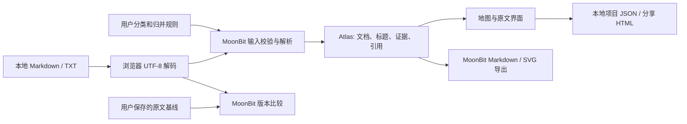

# 架构与数据边界

## 核心数据流

核心无 I/O。输入、规则和图谱都是公开结构类型，支持 JSON 序列化。
`build_atlas` 先整体校验，再按路径排序构建，结果不依赖输入顺序。
浏览器编译目标为 JavaScript；相同核心测试也在 Wasm GC 运行。

## 证据与身份

- 文档 ID 为 `doc:` 加相对路径。
- 标题 ID 包含相对路径、空白/大小写归一后的标题、该标题的出现序号。
  标题前插入普通段落不会改变 ID；修改标题或在之前增加同名标题可能改变身份。
- 每个标题拥有从其行首到下一标题之前的行范围；这不是整个嵌套子树范围。
  证据 quote 最多 1,200 个 Unicode 字符，完整原文保存在项目文档中。
- 文档显示名、主题是外部偏好，不改写源文本。预设优先级：用户主题 > topic 元数据 > 一级目录 > 未分类。
- 完全相同内容按原文逐字比较，不使用哈希和模糊相似性。
- 概念规则显式保存为 name → target。允许链式归并，不允许非平凡循环。
  映射预先解析，所有文档共享结果；不同标点名称仍不同，例如 C 与 C++。

## 解析范围

Markdown 标题仅支持最多三级空格缩进的 ATX `#` 至 `######` 后接空白。
不解析 Setext、列表中的标题、HTML 标题、表格语义或 Markdown 行内样式。
识别反引号/波浪线围栏；忽略四空格和 Tab 缩进代码。TXT 保持原样，不解释元数据或标题。
元数据必须从第一行 `---` 开始，在前 100 行内由 `---` 关闭；仅处理 topic 与简单 tags 列表。

引用扫描支持普通 `[label](relative.md)`、`[[wiki|label]]`。
忽略围栏、缩进代码和单行匹配长度的反引号代码段；不是 CommonMark 解析器。
复杂嵌套括号、带标题参数的链接、引用式链接、跨行代码段和转义细节未完整支持。
相对 `..` 不得越过资料集根目录；URL 编码只处理 `%20`。
Wiki 首先在相对目录查找，其次尝试唯一 basename（含可选 .md/.txt 扩展名）；有多个候选时报告歧义。
路径大小写敏感，避免跨平台大小写折叠后错连。

| 引用状态 | 含义 |
| --- | --- |
| linked | 当前资料集中找到目标文档 |
| fragment_unchecked | 文档存在，锚点未验证 |
| missing / ambiguous | 当前资料集中未找到 / 有多个候选 |
| outside / unsupported | 越出资料集 / 当前语法不支持 |
| external | 外部地址，未请求或核验 |
| attachment_unchecked | 附件路径，未读取或核验 |

## 增量更新与保留判断

原文对比和分类判断分开保存。原文更新记录不把分类调整算成文件修改。
同路径内容不同时标记 updated。只在移除、新增两侧都有唯一非空且完全相同内容时标记 renamed。
若新路径已存在显式分类规则，迁移不会覆盖它。移出的旧路径规则保留在项目里，方便重新加入。
规则数量仍受 200 条限制；大规模历史目录轮换需清理旧规则，后续版本可增加管理界面。

## 本地与导出

默认不使用 localStorage、IndexedDB、网络 API、CDN 或遥测；保存是浏览器文件下载。
HTML 从内嵌 JSON 重建图谱；原文只经 textContent 展示。内嵌 JSON 的 HTML 特殊字符转义，
避免原文中的 script 标签打断载入。HTML 本身是可执行应用，不应把任意外来 HTML 当作可信项目文件。
导入项目请使用 JSON，文件格式和核心输入边界都会重新校验。

开发服务器固定路由白名单，不暴露工作目录。核心不是浏览器或操作系统安全沙箱。

SVG 由核心进行确定性分组布局，只展示主题/文档，长名称显示截取文本并提供完整 title。
HTML 分享保存原文和基线；Markdown 保留全部标题与行号；图谱 JSON 包含有限摘录。
